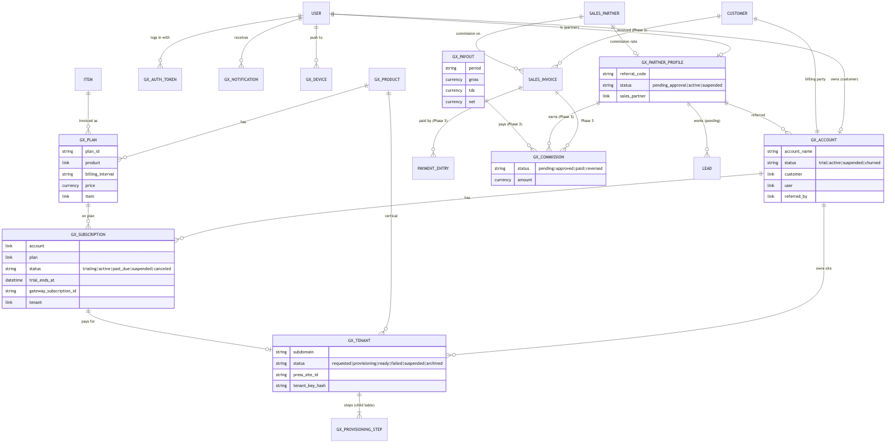
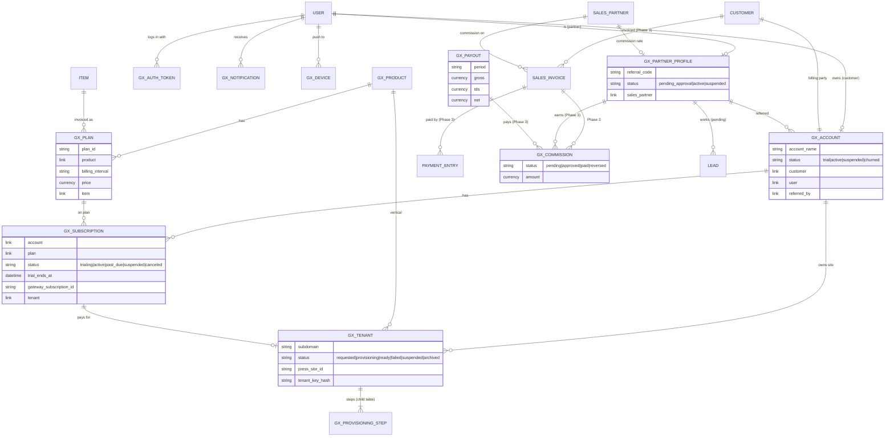

# GrowthX data model

**Task:** Phase 0, deliverable 1 · **Author:** Niranjana C · **Date:** 15 Oct 2026
**For review by:** Sammish (Lead) · **For information:** Mubashir T (Web), Najath Thekkeyil (Flutter), Arun P S (DevOps)
**Versions:** Frappe and ERPNext v16.35.0, MariaDB · **App:** `growthx_core` on the GrowthX Core site

This is the final list of what `growthx_core` stores: our own **GX DocTypes**, and the **ERPNext doctypes** we use
as the system of record for customers, money and partners. The field tables in §6 are generated from the DocType
files in the repo, so they match the code.

**Decision requested:** approve the model, and the choice of a **custom GX Subscription** over ERPNext Subscription (§4).

## 1. Principles

1. **ERPNext is the system of record for money and parties** (core prompt §2, rule 2). Customers, sales partners,
   items, invoices and payments are ERPNext documents. GrowthX DocTypes hold only what ERPNext has no place for:
   products, plans, subscriptions as the gateway sees them, tenant sites, provisioning, partner app data.
2. **Link, don't copy.** A GX DocType links to the ERPNext document (`GX Account.customer`,
   `GX Partner Profile.sales_partner`, `GX Plan.item`) instead of duplicating its data.
3. **Secrets are never stored readable.** Login tokens, refresh tokens, tenant keys and push tokens are stored as
   SHA-256 hashes (push tokens are kept, because FCM needs them, plus a hash for lookups).
4. **Everything is code.** DocTypes, roles (fixtures) and defaults (`after_install`) ship in the app; nothing is set
   up by hand in production.

## 2. Diagram

Mermaid source (GitHub renders it):

Legend: names starting `GX_` are GrowthX DocTypes; the others (`USER`, `CUSTOMER`, `SALES_PARTNER`, `ITEM`, `SALES_INVOICE`, `PAYMENT_ENTRY`, `LEAD`) are Frappe/ERPNext doctypes. Labels with **(Phase 3)** or **(pending)** are planned, not built. GX Appointment, GX Appointment Settings, GX Contact Request and GX Audit Log are left out of the picture to keep it readable (§6).

## 3. From ROLE §2 to the final model

| ROLE §2 concept | Final | Status |
|---|---|---|
| Customer business | ERPNext **Customer** (+ Contact, created by ERPNext from the email and phone) linked from **GX Account** | Built |
| Login users | Frappe **User**, roles `GrowthX Customer`, `GrowthX Partner`, `GrowthX Admin` (fixtures) | Built |
| Product (Solar, Salon …) | **GX Product** (slug, availability, vertical app, Press release group) | Built |
| Plan / price | **GX Plan** (one per product, tier and interval, e.g. `solar-growth-month`), linked to an ERPNext **Item** | Built |
| Subscription | **GX Subscription** (custom; see §4) | Built (statuses and trial); payment fields used from Phase 3 |
| Tenant site | **GX Tenant** | Built |
| Provisioning | **GX Provisioning Step**, a child table of GX Tenant (one row per step: state, attempt, times, error) instead of a separate GX Provisioning Job: one tenant has one job at a time, so the steps live on the tenant | Built |
| Sales partner | ERPNext **Sales Partner** (commission rate) + **GX Partner Profile** (user, status, referral code, profile, notification preferences). The Sales Partner is created when the partner is approved. | Built |
| Referral | **No separate DocTypes at v1.** Each partner has one referral code (`GX Partner Profile.referral_code`); attribution is stored on the account (`GX Account.referred_by`, `referral_code`, `referred_at`) and copied to the ERPNext Customer (`default_sales_partner`) so invoices carry the partner. A **GX Campaign** DocType is added if campaigns are approved. | Built |
| Lead (partner's lead) | ERPNext **Lead** linked to the partner | **Waiting** for the lead rules (Sammish). ERPNext Lead allows one lead per email on the whole site, which is itself a duplicate rule to confirm. |
| Commission | **GX Commission** (partner, account, Sales Invoice, type, base, rate, amount, status) | **Phase 3**, waiting on the commission rules (D8). Today the partner screens read ERPNext's own commission on Sales Invoices. |
| Payout | **GX Payout** (partner, period, gross, TDS, net, status, reference) + its commission lines | **Phase 3** (D8, finance) |
| Billing | ERPNext **Sales Invoice** (GST) and **Payment Entry**, created from the payment gateway's webhook | **Phase 3** |
| Notifications | **GX Notification** + **GX Device** (push tokens) | Built |
| Audit | Frappe version tracking (`track_changes` on business DocTypes) + **GX Audit Log** (retries, sign-in links, tenant sign-ins) | Built |
| Not in ROLE §2 | **GX Auth Token** (API login tokens, hashed), **GX Contact Request** (website contact form), **GX Appointment** + **GX Appointment Settings** ("Talk to an expert", built by Web) | Built |

## 4. Decision: custom GX Subscription, not ERPNext Subscription

**Recommendation: keep the custom GX Subscription** (built). ERPNext still holds the money: every payment becomes
an ERPNext **Sales Invoice** and **Payment Entry**.

What ERPNext v16's Subscription does (checked in `erpnext/accounts/doctype/subscription`): a daily scheduled job
(`process_subscription`) **creates Sales Invoices on its own**, on dates it calculates from the plan
(`generate_invoice_at`), and moves the status between `Trialing`, `Active`, `Grace Period`, `Unpaid`, `Cancelled`
and `Completed`.

| Need | ERPNext Subscription | GX Subscription |
|---|---|---|
| **Who decides a renewal happened** | ERPNext, by date, whether or not money arrived | The **payment gateway** (Razorpay charges the card on its own schedule and tells us by webhook). One source of truth. |
| Invoices | Created by ERPNext's scheduler: would **duplicate or contradict** the gateway's charges | Created **only when the gateway confirms a payment**, with the right amount and GST |
| States GrowthX needs | No `suspended`; no link to the customer's site | `trialing → active → past_due → suspended → canceled`, and a link to the **GX Tenant** to suspend or reactivate the site |
| Gateway ids | None | `gateway`, `gateway_subscription_id`, `last_payment_id` (idempotent webhooks) |
| Time precision | Dates only | Date and time (trial ends at the minute the trial started) |
| API shape | Would need translating anyway | Matches `openapi.yaml` directly |

**What we give up, and how it's covered:**
- ERPNext's built-in renewal reports. Reports on GX Subscription and on Sales Invoice cover it (Phase 4).
- We write the state changes ourselves. They are driven by gateway webhooks, with tests (Phase 3).

**Risk if we chose ERPNext Subscription:** customers invoiced by ERPNext for payments that failed at the gateway,
or invoiced twice; and a second set of states to keep in sync with the gateway's.

## 5. How the main flows touch the model

| Flow | Creates / updates |
|---|---|
| Customer sign-up | User → ERPNext Customer (+ Contact) → GX Account → GX Subscription (`trialing`) → GX Tenant (`requested`) + steps; partner gets a GX Notification |
| Provisioning | GX Tenant status and steps; Press site id; tenant key hash |
| Partner sign-up / approval | User → GX Partner Profile (`pending_approval`) → on approval, ERPNext Sales Partner |
| Login | GX Auth Token (hashes only) |
| Payment (Phase 3) | Gateway webhook → GX Subscription status → ERPNext Sales Invoice + Payment Entry → GX Commission |
| Payout (Phase 3) | GX Payout over approved GX Commissions |

## 6. GrowthX DocTypes: fields and links

Generated from the DocType JSON files. Layout fields (sections, columns) are left out.

#### GX Subscription

module **Billing** · name: `format:GXS-{#####}`

| Field | Type | Notes |
|---|---|---|
| `account` | Link → GX Account | required |
| `plan` | Link → GX Plan | required |
| `product` | Link → GX Product |  |
| `status` | Select: trialing / active / past_due / suspended / canceled |  |
| `tenant` | Link → GX Tenant |  |
| `billing_interval` | Select: month / year |  |
| `price` | Currency |  |
| `gst_included` | Check |  |
| `gst_rate` | Percent |  |
| `trial_ends_at` | Datetime |  |
| `current_period_end` | Datetime |  |
| `cancel_at_period_end` | Check |  |
| `gateway` | Data |  |
| `gateway_subscription_id` | Data |  |
| `last_payment_id` | Data |  |

#### GX Account

module **GrowthX Core** · name: `format:GXA-{#####}`

| Field | Type | Notes |
|---|---|---|
| `account_name` | Data | required |
| `status` | Select: trial / active / suspended / churned | Derived from the account's subscriptions |
| `user` | Link → User | required, unique |
| `contact_email` | Data | required |
| `phone` | Data |  |
| `customer` | Link → Customer | ERPNext Customer (system of record for billing) |
| `referred_by` | Link → GX Partner Profile |  |
| `referral_code` | Data | Referral code used at sign-up |
| `referred_at` | Datetime |  |

#### GX Appointment

module **GrowthX Core** · name: `format:GXA-{#####}`

| Field | Type | Notes |
|---|---|---|
| `full_name` | Data | required |
| `email` | Data | required |
| `phone` | Data | required |
| `company` | Data |  |
| `app` | Link → GX Product |  |
| `status` | Select: Confirmed / Completed / Cancelled / No Show |  |
| `start` | Datetime | required; In the site's timezone. |
| `end` | Datetime | required |
| `expert` | Data |  |
| `meeting_url` | Data |  |
| `notes` | Small Text |  |
| `lead` | Link → Lead |  |
| `event` | Link → Event |  |
| `ip_address` | Data |  |
| `admin_notes` | Small Text | Seen only by the GrowthX team. |
| `cancelled_by` | Select: Visitor / Team |  |
| `cancel_reason` | Small Text |  |
| `reminder_24h_sent` | Check |  |
| `reminder_1h_sent` | Check |  |
| `manage_token_hash` | Data | hidden; SHA-256 of the visitor's manage link token. |

#### GX Appointment Settings

module **GrowthX Core** · name: `hash` · single

| Field | Type | Notes |
|---|---|---|
| `duration_minutes` | Int | required |
| `day_start` | Time | required; In the site's timezone. |
| `day_end` | Time | required; The last call ends by this time. |
| `working_days` | Data | required; Comma-separated: Mon,Tue,Wed,Thu,Fri,Sat,Sun |
| `min_notice_hours` | Int | Slots closer than this are not offered. |
| `holiday_list` | Link → Holiday List | Dates in this list are closed. |
| `experts` | Small Text | One email per line. Each slot can be booked once per expert; each booking goes to the least busy free expert. Leave empty for one call per slot. |
| `meeting_url_template` | Data | Video link for each call, e.g. https://meet.example.com/growthx-{id}. {id} is the appointment id. Leave empty to send the link separately. |

#### GX Audit Log

module **GrowthX Core** · name: `hash`

| Field | Type | Notes |
|---|---|---|
| `actor` | Link → User |  |
| `action` | Data |  |
| `reference_doctype` | Link → DocType |  |
| `reference_name` | Dynamic Link → reference_doctype |  |
| `ip_address` | Data |  |
| `details` | Small Text |  |

#### GX Auth Token

module **GrowthX Core** · name: `hash`

| Field | Type | Notes |
|---|---|---|
| `user` | Link → User | required |
| `client` | Select: web / mobile |  |
| `status` | Select: Active / Revoked |  |
| `access_hash` | Data | unique; SHA-256 of the access token. The token itself is never stored. |
| `access_expires_at` | Datetime |  |
| `refresh_hash` | Data | unique; SHA-256 of the refresh token |
| `refresh_expires_at` | Datetime |  |
| `revoked_at` | Datetime |  |

#### GX Contact Request

module **GrowthX Core** · name: `format:GXC-{#####}`

| Field | Type | Notes |
|---|---|---|
| `full_name` | Data | required |
| `email` | Data | required |
| `company` | Data |  |
| `status` | Select: New / Replied / Closed |  |
| `message` | Text | required |
| `ip_address` | Data |  |

#### GX Plan

module **GrowthX Core** · name: `field:plan_id`

| Field | Type | Notes |
|---|---|---|
| `plan_id` | Data | required, unique; Stable id, e.g. solar-growth-month |
| `product` | Link → GX Product | required |
| `plan_name` | Data | required |
| `billing_interval` | Select: month / year | required |
| `is_active` | Check |  |
| `highlighted` | Check |  |
| `sort_order` | Int |  |
| `price` | Currency | required; Price per billing interval, in rupees |
| `gst_included` | Check | Whether the price already includes GST |
| `gst_rate` | Percent | Used to compute amounts excluding GST (MRR, commission base) |
| `trial_days` | Int |  |
| `item` | Link → Item | ERPNext Item used on Sales Invoices |
| `gateway_plan_id` | Data | Plan id at the payment gateway (e.g. Razorpay plan_...) |
| `description` | Small Text |  |
| `features` | Small Text | One feature per line |

#### GX Product

module **GrowthX Core** · name: `field:slug`

| Field | Type | Notes |
|---|---|---|
| `slug` | Data | required, unique; Stable id used by the website, e.g. solar |
| `product_name` | Data | required |
| `availability` | Select: available / coming_soon | required |
| `category` | Data |  |
| `sort_order` | Int |  |
| `vertical_app` | Data | Frappe app installed on the tenant, e.g. solar_operations |
| `press_release_group` | Data |  |
| `summary` | Small Text |  |

#### GX Device

module **Partners** · name: `hash`

| Field | Type | Notes |
|---|---|---|
| `user` | Link → User | required |
| `token` | Small Text | required; FCM registration token |
| `token_hash` | Data | unique, hidden |
| `platform` | Select: android / ios | required |
| `app_version` | Data |  |
| `last_seen` | Datetime |  |

#### GX Notification

module **Partners** · name: `hash`

| Field | Type | Notes |
|---|---|---|
| `user` | Link → User | required |
| `category` | Select: commission / payout / customer / trial / lead / account | required |
| `title` | Data | required |
| `body` | Small Text |  |
| `deep_link_type` | Select: customer / lead / commission / payout / earnings / profile |  |
| `deep_link_id` | Data |  |
| `read_at` | Datetime |  |
| `dismissed` | Check |  |
| `dedupe_key` | Data | unique, hidden; Stops the same event creating two notifications |

#### GX Partner Profile

module **Partners** · name: `format:GXP-{#####}`

| Field | Type | Notes |
|---|---|---|
| `partner_name` | Data | required |
| `status` | Select: pending_approval / active / suspended |  |
| `user` | Link → User | required, unique |
| `phone` | Data |  |
| `company` | Data |  |
| `referral_code` | Data | required, unique |
| `sales_partner` | Link → Sales Partner | Created when the partner is approved. Commission rate lives here. |
| `city` | Data |  |
| `gstin` | Data |  |
| `tier` | Data | Display label, e.g. Silver Partner (tiers are pending decision D8) |
| `notify_commissions` | Check |  |
| `notify_new_customers` | Check |  |
| `notify_trial_reminders` | Check |  |
| `notify_product_updates` | Check |  |

#### GX Provisioning Step

module **Provisioning** · name: `hash` · child table

| Field | Type | Notes |
|---|---|---|
| `step_key` | Select: create_site / wait_for_site / install_apps / configure / health_check | required |
| `label` | Data |  |
| `state` | Select: pending / running / done / failed |  |
| `attempt` | Int |  |
| `started_at` | Datetime |  |
| `finished_at` | Datetime |  |
| `error` | Small Text |  |

#### GX Tenant

module **Provisioning** · name: `format:GXT-{#####}`

| Field | Type | Notes |
|---|---|---|
| `display_name` | Data |  |
| `account` | Link → GX Account | required |
| `product` | Link → GX Product | required |
| `subscription` | Link → GX Subscription |  |
| `status` | Select: requested / provisioning / ready / failed / suspended / archived |  |
| `subdomain` | Data | unique |
| `site_url` | Data |  |
| `press_site_id` | Data |  |
| `attempts` | Int |  |
| `ready_at` | Datetime |  |
| `tenant_key_hash` | Data | unique, hidden; SHA-256 of the secret this tenant uses to call growthx_core (X-GX-Tenant-Key). The secret itself is only in the tenant's site_config. |
| `status_message` | Small Text | Customer-safe message |
| `last_error` | Small Text | Admin-only detail |
| `steps` | Table → GX Provisioning Step |  |

## 7. ERPNext / Frappe doctypes used

| Doctype | Used for | Created by |
|---|---|---|
| **User** | Every login (customer, partner, admin), with a GrowthX role | Sign-up (`auth.signup`), seed |
| **Role** | `GrowthX Customer`, `GrowthX Partner`, `GrowthX Admin` | Fixtures |
| **Customer** (+ **Contact**) | The customer's business; billing party for invoices. `default_sales_partner` carries the referring partner | Sign-up. ERPNext creates the Contact from the email and phone. |
| **Customer Group**, **Territory** | Required on Customer and Sales Partner | `after_install` creates them if ERPNext's setup wizard hasn't run |
| **Sales Partner** | The partner in ERPNext; holds the commission rate | Approving a GX Partner Profile |
| **Item** | What a plan is invoiced as (`GX Plan.item`) | Admin / seed (Phase 3: one per plan) |
| **Sales Invoice**, **Payment Entry** | Invoices (GST) and payments | Phase 3, from the payment gateway's webhook |
| **Lead** | Partner leads (pending decision); "Talk to an expert" bookings (built by Web) | Appointments today |
| **Event**, **Holiday List** | "Talk to an expert" calendar | Appointments |
| **Error Log** | Technical errors (never shown to clients) | Automatic |

## 8. Open points for review

| # | Question | Recommendation | Who |
|---|---|---|---|
| 1 | Approve GX Subscription over ERPNext Subscription (§4) | Yes | Sammish |
| 2 | Referral: one code per partner at v1, no separate referral DocTypes | Yes; add GX Campaign only if campaigns are approved | Sammish |
| 3 | Provisioning steps as a child table of GX Tenant (no separate job DocType) | Yes | Sammish |
| 4 | Lead rules (duplicates across partners, who changes status) | Needed before partner leads are built | Sammish |
| 5 | Commission and payout fields (GX Commission, GX Payout) | Shapes are in `openapi.yaml`; final fields after D8 | Sammish, finance |
| 6 | Customer `city` (Partner app shows it) | Add an optional city to sign-up and GX Account | Sammish, Mubashir |
