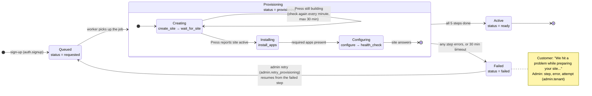

# Tenant provisioning: design

**Task:** Phase 0, deliverable 5 · **Author:** Niranjana C · **Date:** 15 Oct 2026
**For:** Sammish (Lead), Arun P S (DevOps / Press) · **For information:** Mubashir T (Web), Nahala T T (Solar)
**Code:** `growthx_core/provisioning/runner.py` (the job), `press.py` (the Press client), `site_login.py` (single sign-on)

When a customer signs up for a product, `growthx_core` creates their own ERPNext site through Frappe Press. This
document shows the job's states, how it stays safe to repeat and retry, what it records, and what is still needed
from DevOps (§6).

**State today:** the job is built and tested. It runs end to end on a local bench with a stand-in for Press
(`LocalPressClient`: real sites with `bench new-site`) and in tests (`FakePressClient`). The real Press client is
waiting on the answers in §6.

## 1. States

The task's names map onto the tenant's `status` (what Web, Flutter and admins see) and its five steps:

| Task state | `GX Tenant.status` | Step(s) running | What happens |
|---|---|---|---|
| **Queued** | `requested` | — | Sign-up created the tenant and queued the job (background queue `long`) |
| **Creating** | `provisioning` | `create_site`, `wait_for_site` | Ask Press for the site, then wait until Press reports it active |
| **Installing** | `provisioning` | `install_apps` | Check ERPNext, `growthx_theme` and the vertical app (e.g. `solar_operations`) are on the site |
| **Configuring** | `provisioning` | `configure`, `health_check` | Setup wizard (company, country, currency, timezone), the customer's user, single sign-on, then check the site answers |
| **Active** | `ready` | — | Customer can open it ("Open my app"); "site ready" email sent |
| **Failed** | `failed` | the step that failed | Customer sees a friendly message; admin sees the error and retries |

Later (Phase 3): `ready → suspended` on non-payment, `suspended → ready` when paid, `→ archived` on cancellation.

## 2. State diagram



Picture: [`provisioning-state-diagram.png`](provisioning-state-diagram.png). Text version (for places that don't render Mermaid):

```
 sign-up
    │
    ▼
┌──────────┐  worker   ┌──────────────────────── Provisioning ─────────────────────────┐   all steps   ┌────────┐
│  Queued  │──────────►│ Creating ──────────► Installing ──────────► Configuring        │──────────────►│ Active │
│requested │           │ create_site          install_apps           configure          │     done      │ ready  │
└──────────┘           │ wait_for_site ◄─┐                           health_check       │               └────────┘
     ▲                 │       └─────────┘ Press still building: re-check every minute│
     │                 └───────────────────────────────┬────────────────────────────────┘
     │                                                 │ a step errors, or 30 min timeout
     │   admin retry (resumes from the failed step)    ▼
     └───────────────────────────────────────────┌──────────┐
                                                 │  Failed  │
                                                 │  failed  │
                                                 └──────────┘
```

## 3. The five steps

| # | Step | Calls Press for | Done when | Fails when |
|---|---|---|---|---|
| 1 | `create_site` | Create `<subdomain>` in the product's release group with its apps. **Skipped if the tenant already has a Press site id** | Press returns a site id; it is saved at once | Press refuses (name taken, quota, auth) |
| 2 | `wait_for_site` | Site status | Press says `active` | Press says `broken`, or 30 min pass |
| 3 | `install_apps` | Installed apps | `erpnext`, `growthx_theme` and the vertical app are installed | Any is missing |
| 4 | `configure` | Run set-up on the site + write two site_config keys | Wizard done, owner user exists, `growthx_core_url` and `growthx_tenant_key` written, "Login with Email Link" on | Set-up errors |
| 5 | `health_check` | — (calls the site) | The site answers | No answer |

What `configure` sends (from `runner.tenant_settings`): company name, country `India`, currency `INR`, timezone
`Asia/Kolkata`, owner email and name, the Core URL, and a new per-tenant key (only its hash is kept in Core).
The owner user gets a random password nobody knows; customers sign in through GrowthX ("Open my app").
The Solar-specific set-up method is being agreed with Nahala and will be added to this step.

## 4. Guarantees

| Requirement | How |
|---|---|
| **Idempotent** (running twice never creates two sites) | The Press site id is saved the moment Press returns it, and `create_site` is skipped when it is set. Before creating, it asks Press whether `<subdomain>` already exists (`find_site`). Only one job per tenant can be queued (`job_id = gx-provision::<tenant>`, deduplicated), and the tenant row is locked while a run updates it (`for_update`). Subdomains are unique (`-2`, `-3` … is added if taken; reserved names like `www`, `api`, `admin` get `-site`). |
| **Retryable** (from the failed step) | `admin.retry_provisioning` sets the failed step back to `pending` and the tenant to `requested`. Finished steps are skipped. A retry while a job is running returns the running job instead of starting another. Each run increases `attempts`. |
| **Doesn't block workers** | While Press is building, `wait_for_site` stops and the job ends. A scheduler job every minute (`resume_pending`) runs it again, and also restarts jobs whose worker died (no change for 2 minutes). |
| **Logged** | Each step stores `state`, `attempt`, `started_at`, `finished_at` and `error` on the tenant (`GX Provisioning Step`). The tenant stores `attempts` and `last_error`. Failures also go to the Frappe Error Log; admin retries go to `GX Audit Log`. |
| **Timed** | Step start and finish times give how long each step took. |
| **Visible** | Customers: `customer.site` (status, customer-safe message, step progress). Admins: `admin.tenants`, `admin.tenant` (error, attempt per step), and the desk (`/app/gx-tenant`). |
| **Safe messages** | Customers only ever see a friendly message; the technical error is admin-only. |

## 5. After the site is ready

- "Your GrowthX site is ready" email to the customer.
- (At sign-up, before provisioning, the referring partner gets a "New customer" notification: PR `feat/partner-app-api`.)
- "Open my app" signs the customer in with a one-time link (see `api-decisions.md` and the `growthx_theme` app).

## 6. Questions for DevOps (Arun P S)

These decide how the real Press client (`RealPressClient` in `press.py`) is written. Sent to Arun on 15 Oct 2026.

**A. Access**
1. Self-hosted Press on AWS, or Frappe Cloud (decision D2)? The API differs between them.
2. The Press API base URL for staging and for production.
3. A scoped API token for Core: how is it created, what can it do, and how is it sent (header format)? One per
   environment. Where do I read it (Secrets Manager or site_config)?

**B. Creating a site**
4. Endpoint and payload to create a site: subdomain, release group (bench group), apps, plan, server or cluster.
5. Is creation asynchronous? What does it return (site id, job id)?
6. Subdomain rules: allowed characters, maximum length, reserved names. What happens if the name is already taken?
7. Can I look up a site by its subdomain (so a retry finds a site created by an earlier attempt)?

**C. Status and timing**
8. Endpoint to read a site's status, and the list of possible values (which mean "building", "ready", "broken")?
9. Is there a webhook or callback when the site is ready, or should Core keep polling (today: every minute)?
10. Typical creation time on staging, and the longest you'd expect (today's timeout: 30 minutes)?
11. Can Core read the job log for a failed creation, to show admins the reason?

**D. Apps**
12. Are the apps installed during creation from the release group? How can Core check which apps (and versions)
    are installed?
13. Endpoint to install one app on an existing site (to add `growthx_theme` to older sites).

**E. Configuring the new site** (most important)
14. How can Core run set-up on the new site: the ERPNext setup wizard (company, country, currency, timezone,
    fiscal year), create the customer's user, enable "Login with Email Link"? Options I see: Press passes setup
    data at creation; Press gives Core an Administrator API key for the site; or Press runs a command for us.
    Which one does Press support?
15. Endpoint to set **site_config** keys on a tenant (`growthx_core_url`, `growthx_tenant_key`). The key is a
    secret: can it be set without appearing in Press logs?
16. How does Core call a method in `solar_operations` on the new site (the set-up Nahala and I are agreeing)?

**F. Domains, network, email**
17. Tenant URL pattern (decision D3), e.g. `<subdomain>.<tenant-domain>`, with wildcard SSL. Is SSL automatic?
18. Network: tenants must reach Core server-to-server (single sign-on calls `tenant.redeem_login`). Which Core
    URL should tenants use, and is that traffic allowed?
19. Outgoing email (SES) on Core and on tenants, for "site ready", password reset and email-link login.

**G. Lifecycle and limits**
20. Endpoints to suspend, re-activate, archive and delete a site (Phase 3). What do users see when it is suspended?
21. Rate limits and how many sites can be created at the same time.
22. A failed creation: is it safe to delete it and create again with the same subdomain?

**H. Access and timeline**
23. Can I have read access to the staging Press dashboard, to debug provisioning?
24. When can Core staging call the Press API? The go/no-go for Press is the end of Week 3 (30 Oct).

## 7. Open items

| Item | Owner |
|---|---|
| Answers to §6 → write `RealPressClient` | Arun → Niranjana |
| Solar set-up method called by `configure` | Nahala + Niranjana |
| Trial start: at sign-up (current) or when the site is ready (OI-2) | Sammish |
| Suspend / archive flow | Phase 3 |
